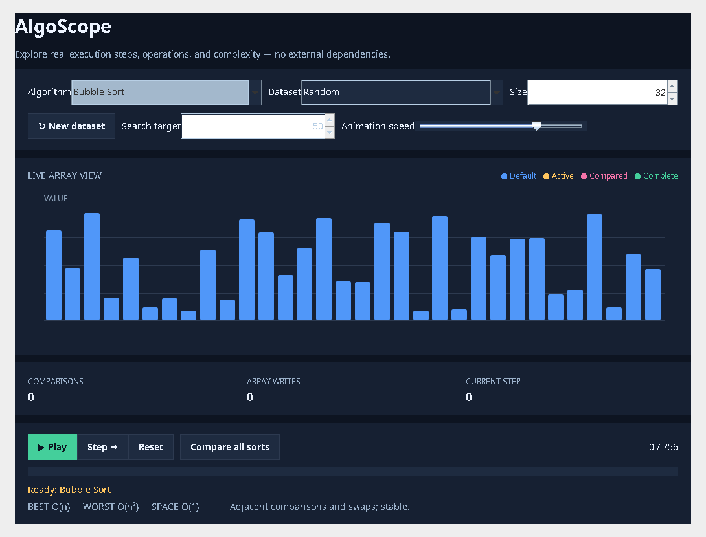

# AlgoScope — Interactive Java Algorithm Visualizer

**Explore how algorithms actually work.** AlgoScope is an interactive desktop application written in **Java 17 and Swing**. It animates sorting and binary search step by step, tracks comparisons and array writes, and compares multiple algorithms on the exact same dataset.

   



> **Educational portfolio project:** Uses randomly generated sample values. No external libraries, internet access, API keys, or database are required.

## Features

- **Animated algorithm execution:** watch comparisons and array updates on a color-coded bar chart.
- **Six algorithms:** Bubble Sort, Insertion Sort, Selection Sort, Merge Sort, Quick Sort, and Binary Search.
- **Playback controls:** Play, Pause, Step, Reset and adjustable animation speed.
- **Dataset options:** Random, Ascending, Descending, Nearly sorted, and Many duplicates, with configurable size (5–100).
- **Binary search:** automatically sorts the dataset first and searches for a specified target; shows the found index or a not-found message.
- **Metrics:** number of comparisons, array writes, and progress through recorded steps.
- **Complexity reference:** best-case and worst-case time complexity plus auxiliary-space complexity.
- **Side-by-side comparison:** results table for all five sorting algorithms on identical inputs, with operations and illustrative elapsed time.
- **Automated tests:** seeded randomized regression cases, edge cases, immutable history tests, and dataset checks.
- **Continuous integration:** GitHub Actions compiles with Java 17 and runs regression tests on pushes and pull requests.

## Quick start — IntelliJ IDEA (recommended)

1. Install **JDK 17 or newer** and open **IntelliJ IDEA**.
2. Choose **File → Open**, select the extracted **`AlgoScope`** folder, and click **Open as Project** if prompted.
3. Open **File → Project Structure → Project**, and select your installed **JDK 17+** as the Project SDK (language level 17 or higher).
4. In the Project pane, right-click **`src/main/java` → Mark Directory as → Sources Root** if IntelliJ has not detected it.
5. Navigate to **`src/main/java/com/algoscope/Main.java`**, right-click the file and select **Run 'Main.main()'**.
6. The desktop UI opens. Choose an algorithm and press **▶ Play** (or **Step →**).

**Run the tests in IntelliJ:** mark `src/test/java` as **Test Sources Root**, then right-click `EngineTest.java` and run `EngineTest.main()`. The suite is a standalone Java main-method harness, so **no JUnit plugin or dependency is needed**.

## Quick start — Terminal

Requires Java 17+, `javac`, and a desktop environment.

**macOS / Linux**

```bash
./run.sh       # compile and launch the desktop app
./test.sh      # compile and execute regression assertions
```

**Windows Command Prompt**

```bat
run.bat
test.bat
```

**Manual commands (any platform, from repository root)**

```bash
mkdir -p build/classes
find src/main/java src/test/java -name '*.java' > build/sources.txt
javac --release 17 -d build/classes @build/sources.txt
java -ea -cp build/classes com.algoscope.EngineTest
java -cp build/classes com.algoscope.Main
```

The `find` command above is for macOS/Linux; on Windows, use the included `.bat` scripts.

## How to use

1. Select **Bubble, Insertion, Selection, Merge, Quick**, or **Binary Search**.
2. Choose a dataset type and size. Click **New dataset** for new values.
3. Use **Play** to animate, **Pause** to stop, **Step** for individual operations, and **Reset** to return to the first frame.
4. Change **Animation speed** as needed. Yellow highlights the active index, pink highlights the second index, and green indicates a completed sorted array.
5. Choose **Compare all sorts** to open the benchmark table for the current input.

**Binary Search:** AlgoScope uses an ascending sorted copy of the generated values, as required by binary search. Edit **Search target** to find a specific value; indices are **zero-based**.

## Algorithm reference

| Algorithm | Best time | Worst time | Auxiliary space | Notes |
| --- | --- | --- | --- | --- |
| Bubble Sort | O(n) | O(n²) | O(1) | Stable, early-exit optimization |
| Insertion Sort | O(n) | O(n²) | O(1) | Stable, good on nearly sorted arrays |
| Selection Sort | O(n²) | O(n²) | O(1) | Not stable; comparatively few swaps |
| Merge Sort | O(n log n) | O(n log n) | O(n) | Stable, divides and merges |
| Quick Sort | O(n log n) | O(n²) | O(log n) average | In-place Lomuto partition, last-element pivot; recursion can grow to O(n) worst case |
| Binary Search | O(1) | O(log n) | O(1) | Requires ascending sorted input |

*The operation counter measures comparisons and array writes; a swap of distinct indices counts as two array writes. Counters do not include auxiliary-array copying, loop checks or allocations. The complexity table is asymptotic reference information, not a prediction of wall-clock duration.*

## Design and architecture

```text
AlgoScope/
├── .github/workflows/java-ci.yml      # GitHub Actions Java 17 CI
├── docs/algoscope-preview.png          # Screenshot of running app
├── .gitignore
├── src/
│   ├── main/java/com/algoscope/
│   │   ├── Main.java                 # Swing entry point
│   │   ├── core/
│   │   │   ├── Algorithm.java        # Algorithm names and complexities
│   │   │   ├── Benchmark.java        # Comparable low-overhead runs
│   │   │   ├── Datasets.java         # Reproducible input shapes
│   │   │   ├── Engine.java           # Sorting/search implementations
│   │   │   ├── Frame.java            # Immutable visualization snapshot
│   │   │   └── RunResult.java        # Algorithm output / history
│   │   └── ui/
│   │       ├── MainWindow.java       # Controls, metrics and comparison table
│   │       ├── BarPanel.java         # Custom bar-chart renderer
│   │       └── Theme.java            # Dark UI palette / styling
│   └── test/java/com/algoscope/
│       └── EngineTest.java           # Dependency-free regression suite
├── run.sh / run.bat
├── test.sh / test.bat
├── LICENSE
└── README.md
```

The **core engine is independent of Swing**, making sorting/search logic testable without launching a window. Animation uses recorded **immutable frames** while the benchmark executes without intermediate-frame allocations. All algorithms receive copies of the same baseline input in comparison mode. The Swing `Timer` updates playback on the Event Dispatch Thread (EDT).

## Benchmark caveat

The table shows one elapsed-time measurement per algorithm. Small inputs, JVM warm-up, JIT compilation, and CPU scheduling can substantially affect these figures. Use **comparison and write counts** for more reproducible comparisons. This feature is an educational visual comparison, **not** a statistically rigorous Java microbenchmark (JMH).

## Running CI

Open the repository's **Actions → Java CI** tab. Each push and pull request triggers compilation and the assertion suite. You can also select **Run workflow** to execute it manually.

## Future extensions

- Graph traversal algorithms (BFS, DFS, Dijkstra)
- Array imports and exportable benchmark reports
- Accessibility improvements and keyboard shortcuts
- JMH microbenchmark module for rigorous runtime measurements

## License

MIT — see [LICENSE](LICENSE).
